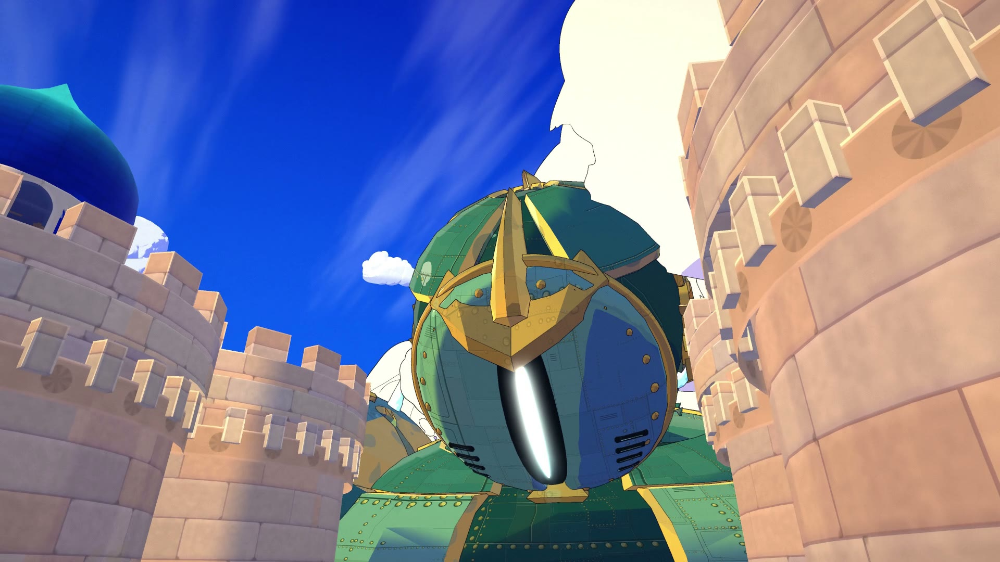
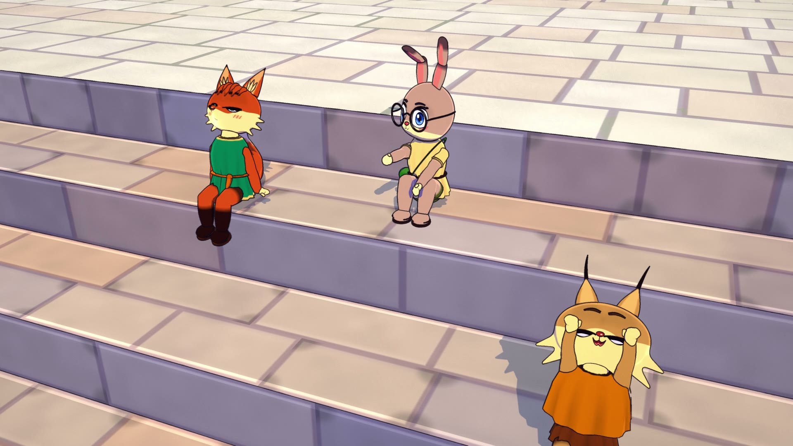
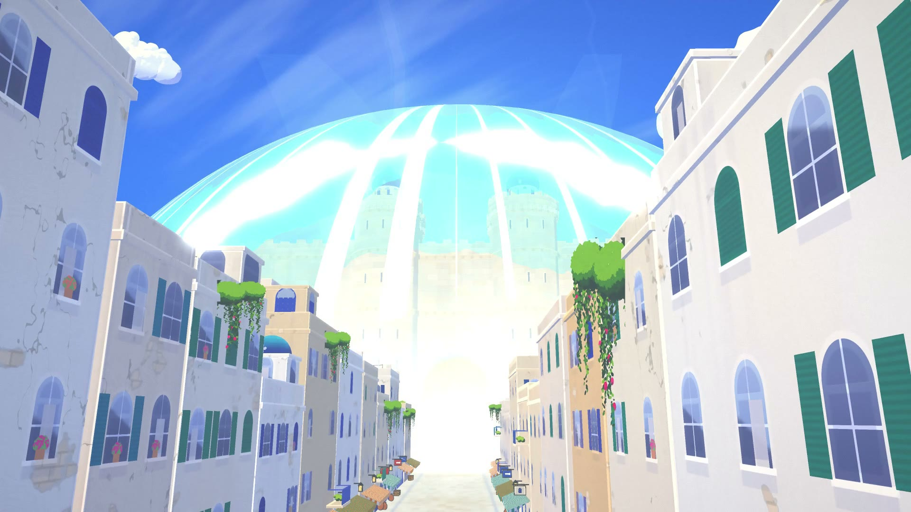
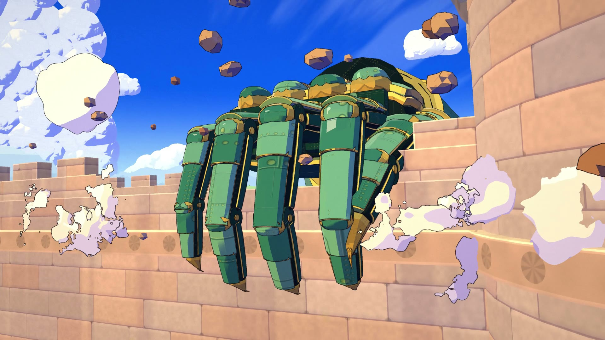
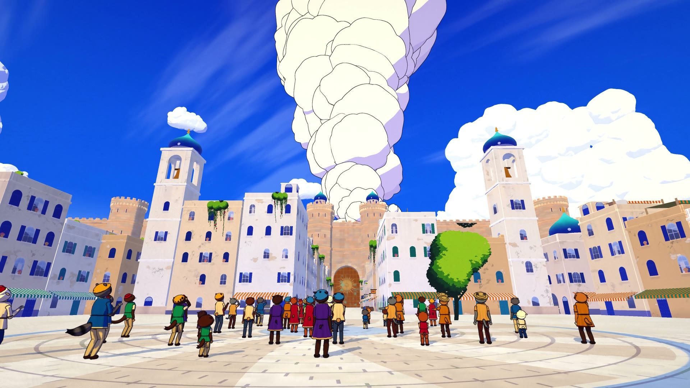
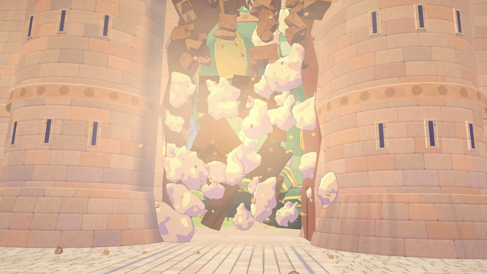
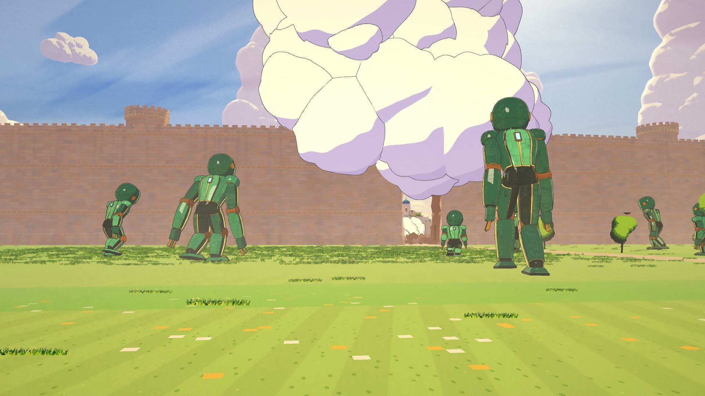

# COLOSSUS · 巨像

A 77-second anime short where every frame is made by code: no video model, no image model, no hand-drawn frames.
A peaceful afternoon in a white hill town of animal folk. A cyan bolt strikes beyond the great sandstone wall, a dome of
light swells, a shock wave runs over the roofs and a column of steam boils up behind the gate. A bronze hand slams onto
the wall top, a 90 m automaton raises its head over the wall and stares down at the town, lifts its leg and kicks the
gate in. Boulders rain on the roofs, the folk run from a wall of dust, and smaller automatons walk toward the breach.

The scene is a shot-for-shot retelling of a famous anime opening: the same actions, staging and timing, with every
visual (town, characters, giant, colours) designed from scratch.



| | |
|---|---|
|  |  |
|  |  |
|  |  |

**Watch:** [film/colossus.mp4](film/colossus.mp4) (1920×1080, 24 fps, 77.5 s; click "View raw" to download).

Made with Claude Opus 5.5 in Claude Code.

---

## How it looks like anime

three.js (WebGL2) builds the whole world in the browser and a chain of full-screen passes draws every frame the way a
cel + painted-background production would:

| Pass | What it does |
|---|---|
| shadow | one sun shadow map with hard cel edges |
| main (MRT) | colour with cel light and cool lavender shadows, plus depth, object id, material id and normals |
| paint | Kuwahara gouache brush on the backgrounds only (houses, wall, sky, fields) |
| ink | lines from object-id, depth and normal edges, only where a material asks for ink; thinner far away |
| atmosphere | haze, sun, dust after the kick |
| overlay / bloom / final | steam, sparks and flashes drawn as inked 2D-style billows; glow on the visor slit and the bolt; high-key grade, vignette |

* **Everything is 3D under the drawing.** About 7,400 houses with roof terraces, awnings, domes, laundry lines and
  bougainvillea, a 50 m crenellated wall with round towers, a bronze gate carved with a sun, a canal with steps, a square
  with two bell towers; a 90 m bronze automaton built from plates, rivets and pistons; 47 animal townsfolk (fox, hare,
  lynx, badger, goat, bears, deer, dogs, sheep, raccoons, otters, boars) on a shared rig with anime faces.
* **Animation is on twos**, like film anime; the giant moves slowly and heavily.
* **One map and one clock.** `src/layout.js` is the shared map in metres and `src/shots.js` holds the story cues and the
  31 shots; every department places and times things from those numbers, so the world stays continuous across cuts.
* **Checked before rendering.** `tools/qa.mjs` tests every frame on the real geometry with BVH trees (no hand, foot or
  body inside the steps, walls, gate or another body; the camera never inside a mesh or under the ground),
  `tools/smooth.mjs` flags camera jerks and `tools/pops.mjs` flags anything that appears or vanishes mid-shot.
* **The score uses real orchestral samples** (VSCO-2-CE and VCSL, both CC0) plus a formant choir and designed SFX, all
  mixed from code in `audio/render.py`, with every boulder impact read from the film and landed on picture
  ([audio/NOTES.md](audio/NOTES.md)).

## How it was made

One director session and parallel agent teams in Claude Code, working from a shared contract
([CONTRACT.md](CONTRACT.md)): town, giant, characters, FX, sound. Each team owned its own files and cameras and rendered
stills to check its work before the final render.

## Run it

Requirements: Node 18+, Google Chrome (set `CHROME` if it is not in the default place), `ffmpeg` on `PATH`, and
Python 3.11+ with `numpy`, `scipy` and `soundfile` for the score.

```bash
npm install
npx http-server . -p 8080        # or any static server; open http://localhost:8080 for the scrubbable workbench
node tools/check.mjs 60          # load check
node tools/qa.mjs --step 2       # BVH checks on every second frame
node tools/snap.mjs t:47 s:s20@0.5 --scale 0.5
```

Build the score (downloads ~1.5 GB of CC0 samples once):

```bash
python -I audio/tools/fetch_samples.py
python -I audio/tools/build_index.py
node audio/tools/dump_cues.mjs
python -I audio/render.py
```

Render all 1,860 frames and mux the film with `out/soundtrack.wav`:

```bash
node tools/render.mjs --scale 2 --name colossus
```

## Layout

```
CONTRACT.md         the production contract: shot list, designs, map, file ownership, APIs, QA rules
index.html          the workbench (scrub / play) and the headless render page
src/engine.js       the render passes; look.js the grade presets; world.js the sky
src/layout.js       the shared map; shots.js the cues and the 31 shots
src/town*.js        the town, wall and gate          src/colossus*.js  the giant, its pose and the small automatons
src/folk*.js        the animal folk: rig, faces, species, acting, crowd     src/fx*.js  bolt, flash, shock, steam, debris, dust
src/cams/*.js       each department's cameras and looks for its shots
tools/              check, snap, sheet, qa, smooth, pops, render
audio/              the score, its sample engine, SFX, cue sheet and credits
vendor/             three.js r170, three-mesh-bvh, addons
```

## Credits and license

MIT. The render engine and some modelling and FX code are adapted from the Leviathan project (MIT,
[vendor/LEVIATHAN-LICENSE](vendor/LEVIATHAN-LICENSE)). three.js and three-mesh-bvh are MIT. Orchestral samples:
VSCO-2-CE and VCSL by Versilian Studios, CC0 ([audio/CREDITS.md](audio/CREDITS.md)); they are downloaded by the fetch
script, not stored here.
